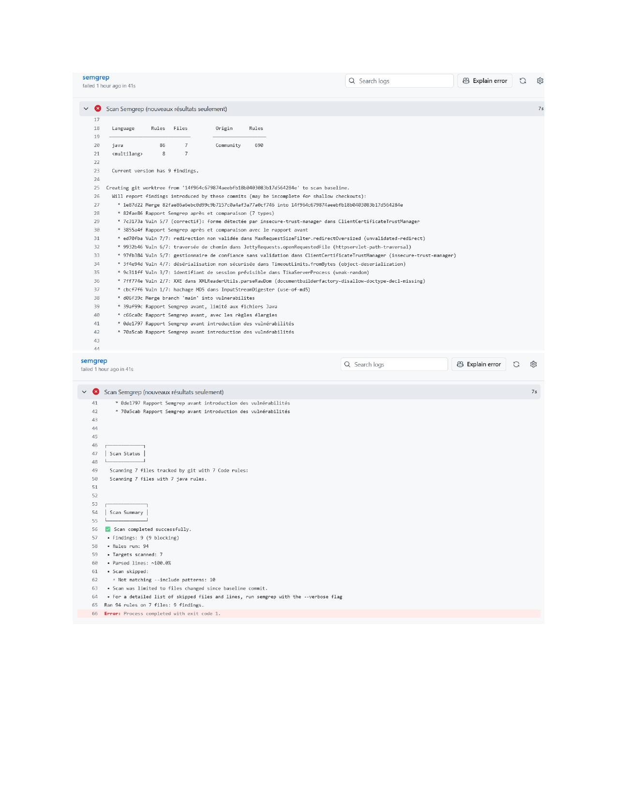
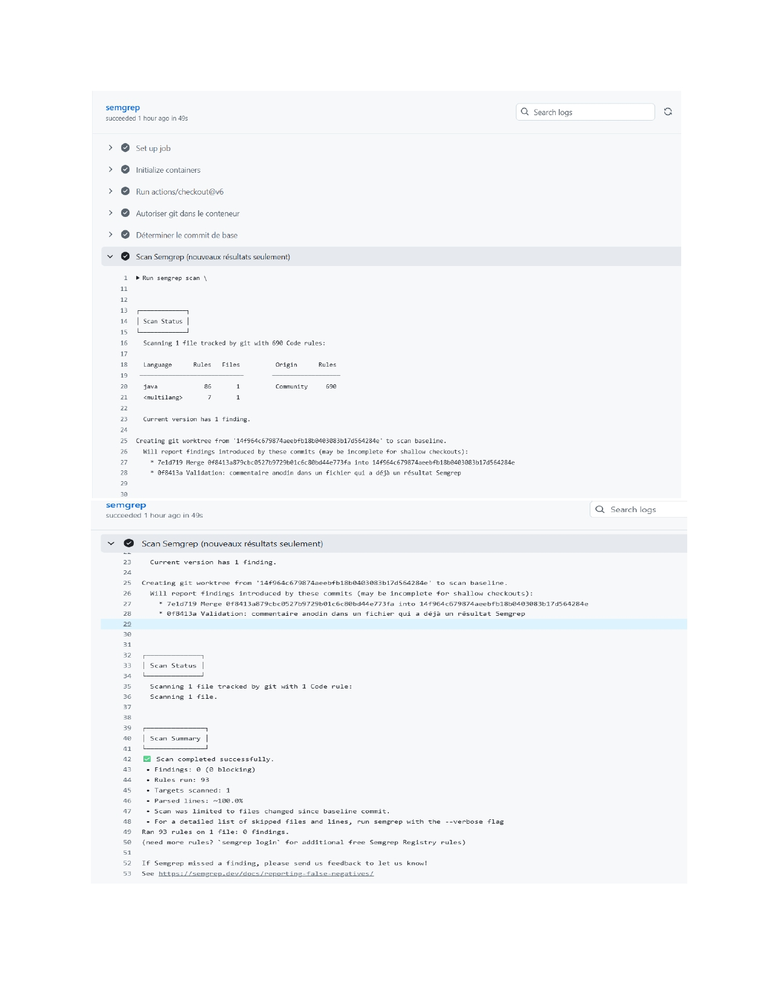
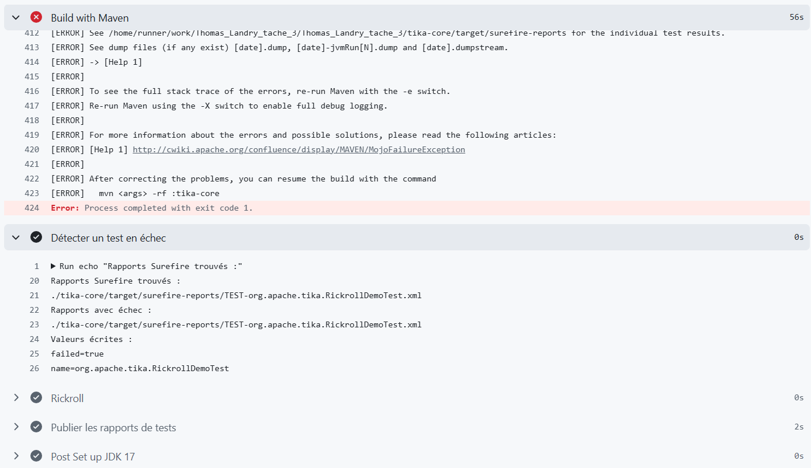
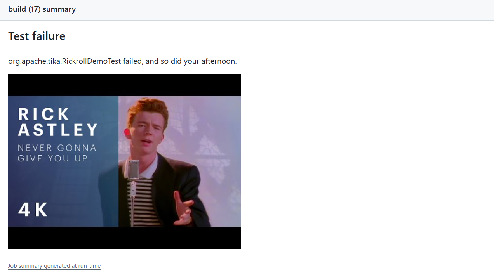

# Tâche 3 (IFT3913) : Semgrep dans le CI, vulnérabilités et rickroll

Membres : Thomas Ring, Vianney Landry Ntebou soutsing


## 0. Résumé et pièces justificatives

| Élément | Où le trouver |
|---|--|
| Workflow modifié | [`.github/workflows/main-jdk17-build.yml`](.github/workflows/main-jdk17-build.yml) (branche `main`) |
| Action de rickroll | [`.github/actions/rickroll/action.yml`](.github/actions/rickroll/action.yml) (branche `main`) |
| Les 7 vulnérabilités | branche [`vulnerabilites`](https://github.com/landry000/Thomas_Landry_tache_3/tree/vulnerabilites), un commit par vulnérabilité |
| Rapports Semgrep | [`rapports/`](https://github.com/landry000/Thomas_Landry_tache_3/tree/vulnerabilites/rapports) (branche `vulnerabilites`) |
| Run rouge (PR `vulnerabilites` vers `main`) | <https://github.com/landry000/Thomas_Landry_tache_3/actions/runs/43153504110> |
| Run vert (PR `validation-ok` vers `main`) | https://github.com/landry000/Thomas_Landry_tache_3/actions/runs/43156503518 |
| Run vert (push sur `main`) | https://github.com/landry000/Thomas_Landry_tache_3/actions/runs/43152486029 |
| Run du rickroll (PR `rickroll-demo`) | https://github.com/landry000/Thomas_Landry_tache_3/actions/runs/43151045889 |

Le code étudié est Apache Tika, version publiée **4.2.0** (voir la section 6 pour savoir pourquoi ce choix).

## 1. Modification du workflow GitHub Actions

### 1.1 Objectif

Le build doit échouer lorsqu'un commit introduit une **nouvelle** vulnérabilité détectée par Semgrep. Les résultats qui existaient déjà dans Tika ne doivent pas faire échouer le build, sinon aucun commit ne passerait.

### 1.2 Implémentation

Un job `semgrep` a été ajouté à `.github/workflows/main-jdk17-build.yml`, à côté des jobs `build` et `e2e-tests`, qui n'ont pas été modifiés (hors le rickroll de la section 5).

```yaml
  semgrep:
    runs-on: ubuntu-latest
    timeout-minutes: 15
    container:
      image: semgrep/semgrep
    steps:
      - uses: actions/checkout@v6
        with:
          fetch-depth: 0
      - name: Autoriser git dans le conteneur
        run: git config --global --add safe.directory "$GITHUB_WORKSPACE"
      - name: Déterminer le commit de base
        id: base
        run: |
          if [ "${{ github.event_name }}" = "pull_request" ]; then
            BASE="${{ github.event.pull_request.base.sha }}"
          else
            BASE="${{ github.event.before }}"
            if [ -z "$BASE" ] || [ "$BASE" = "0000000000000000000000000000000000000000" ]; then
              BASE="$(git rev-parse HEAD~1)"
            fi
          fi
          echo "sha=$BASE" >> "$GITHUB_OUTPUT"
      - name: Scan Semgrep (nouveaux résultats seulement)
        run: |
          semgrep scan \
            --metrics=off \
            --config p/java --config p/security-audit \
            --config p/owasp-top-ten --config p/command-injection \
            --include='*.java' \
            --baseline-commit "${{ steps.base.outputs.sha }}" \
            --sarif --output semgrep.sarif \
            --error
      - name: Publier le rapport SARIF
        if: always()
        uses: actions/upload-artifact@v4
        with:
          name: semgrep-sarif
          path: semgrep.sarif
```

### 1.3 Choix de conception et justifications

| Choix | Justification |
|---|---|
| `--baseline-commit` | Semgrep ne rapporte que les résultats absents du commit de base. Les résultats déjà présents dans Tika ne bloquent donc pas le build. |
| `--error` | Semgrep retourne un code de sortie non nul s'il reste au moins un résultat, ce qui fait échouer le job. |
| Commit de base | Pour une PR, le commit de base de la PR. Pour un push, l'état avant le push (`github.event.before`). Pour une nouvelle branche, où cette valeur ne contient que des zéros, on se rabat sur `HEAD~1`. |
| `fetch-depth: 0` | Le commit de base doit être disponible dans le dépôt cloné. |
| `git config ... safe.directory` | Git refuse sinon de lire le dépôt dans le conteneur Semgrep (propriétaire différent). |
| Job séparé, en parallèle du build | Le build Maven dure longtemps ; Semgrep donne son verdict en quelques minutes et indépendamment de lui. |
| Rapport SARIF avec `if: always()` | Le rapport est conservé même quand le job échoue : il sert de pièce justificative. |
| Jeux de règles élargis | `p/java` seul ne détecte que quelques types (surtout de la cryptographie) : il n'a pas détecté la désérialisation, la traversée de chemin, l'aléatoire faible ni les redirections. Nous avons ajouté `p/security-audit`, `p/owasp-top-ten` et `p/command-injection`. |
| `--include='*.java'` | Avec les règles élargies, des fichiers YAML (workflows) et Python déclenchent déjà 40 résultats (par exemple 29 pour `github-actions-mutable-action-tag`). Sans cette restriction, tout commit qui touche à `.github/workflows/` ferait échouer le job sans rapport avec le code. |
| Mêmes règles en local et dans le CI | Les rapports « avant » et « après » ont été produits avec exactement les mêmes options que le CI. |

### 1.4 Validation

Nous avons simulé le CI en local avec `semgrep scan --baseline-commit main` avant de pousser, puis vérifié sur GitHub trois situations.

| Situation | Résultat attendu | Résultat observé | Preuve |
|---|---|---|--|
| Commit qui ajoute des vulnérabilités (PR `vulnerabilites` vers `main`) | `semgrep` rouge | rouge | <https://github.com/landry000/Thomas_Landry_tache_3/actions/runs/43153504110> |
| Commentaire sans effet dans un fichier Java qui avait **déjà** un résultat Semgrep (PR `validation-ok`) | `semgrep` vert | vert | https://github.com/landry000/Thomas_Landry_tache_3/actions/runs/43156503518 |
| Push de la branche `rickroll` dans `main` (aucun fichier Java modifié) | `semgrep` vert | vert | https://github.com/landry000/Thomas_Landry_tache_3/actions/runs/43151045889 |

La deuxième ligne est la plus importante : elle montre que les résultats déjà présents dans Tika ne bloquent pas le build et que seule une vulnérabilité **nouvelle** fait échouer le job.

**Image du job `semgrep` rouge** avec la liste des résultats 

**Image du job `semgrep` vert** .

Le rapport SARIF du run rouge est disponible comme artefact `semgrep-sarif` de ce run (`semgrep.sarif`).

## 2. Les 7 vulnérabilités

Chaque vulnérabilité est introduite par **un commit séparé** sur la branche `vulnerabilites`. Avant de commiter, nous avons vérifié avec Semgrep que la vulnérabilité était détectée, et le rapport correspondant est dans `rapports/vulnN-*.json`.

| N° | Type | CWE | Fichier modifié | Règle Semgrep | Commit                                                                                                                                                                                                                                            |
|---|---|---|---|---|---------------------------------------------------------------------------------------------------------------------------------------------------------------------------------------------------------------------------------------------------|
| 1 | Algorithme de hachage faible (MD5) | 327 | `tika-core/.../digest/InputStreamDigester.java` | `use-of-md5` | [cbcf7f64](https://github.com/landry000/Thomas_Landry_tache_3/commit/cbcf7f64)                                                                                                                                                                    |
| 2 | Injection d'entité externe XML (XXE) | 611 | `tika-core/.../utils/XMLReaderUtils.java` | `documentbuilderfactory-disallow-doctype-decl-missing` | [7ff774e3](https://github.com/landry000/Thomas_Landry_tache_3/commit/7ff774e3)                                                                                                                                                                    |
| 3 | Générateur pseudo-aléatoire prévisible | 338 | `tika-server/.../core/TikaServerProcess.java` | `weak-random` | [9c311ff4](https://github.com/landry000/Thomas_Landry_tache_3/commit/9c311ff4)                                                                                                                                                                    |
| 4 | Désérialisation de données non fiables | 502 | `tika-core/.../config/TimeoutLimits.java` | `object-deserialization` | [3f4e94d1](https://github.com/landry000/Thomas_Landry_tache_3/commit/3f4e94d1)                                                                                                                                                                    |
| 5 | Validation de certificat désactivée | 295 | `tika-server/.../core/ClientCertificateTrustManager.java` | `insecure-trust-manager` (3 résultats) | [97fb3847](https://github.com/landry000/Thomas_Landry_tache_3/commit/97fb3847), correctif [7c3173a3](https://github.com/landry000/Thomas_Landry_tache_3/commit/7c3173a3): c'est ce dernier commit qui rend la vulnérabilité détectable par semgrep |
| 6 | Traversée de répertoire | 22 | `tika-server/.../core/JettyRequests.java` | `httpservlet-path-traversal` | [9932b462](https://github.com/landry000/Thomas_Landry_tache_3/commit/9932b462)                                                                                                                                                                    |
| 7 | Redirection ouverte | 601 | `tika-server/.../core/MaxRequestSizeFilter.java` | `unvalidated-redirect` | [ed70fba7](https://github.com/landry000/Thomas_Landry_tache_3/commit/ed70fba7)                                                                                                                                                                    |

Nous avons volontairement choisi des types de familles différentes (cryptographie, XML, entrées utilisateur, sérialisation, réseau) et des règles qui ne figuraient pas dans le rapport d'origine, pour que la comparaison avant/après se lise par nom de règle.

### 2.1 Hachage faible (MD5)

- **Fichier choisi** : `InputStreamDigester`, la classe de Tika qui calcule des empreintes. Une méthode de « somme de contrôle héritée » y est plausible.
- **Code introduit** :
  ```java
  static byte[] legacyChecksum(byte[] data) throws java.security.NoSuchAlgorithmException {
      return MessageDigest.getInstance("MD5").digest(data);
  }
  ```
- **Pourquoi c'est vulnérable** : MD5 n'est plus résistant aux collisions. Deux contenus différents peuvent avoir la même empreinte, ce qui permet de falsifier un fichier sans changer son hachage. Il faudrait utiliser SHA-256 ou mieux.
- **Résultat Semgrep** : `use-of-md5` (voir `rapports/vuln1-md5.json`).

### 2.2 XXE

- **Fichier choisi** : `XMLReaderUtils`, l'utilitaire de lecture XML. Le reste de la classe utilise des fabriques sécurisées (`SecureDocumentBuilderFactory`, etc.) : la nouvelle méthode contourne cette protection.
- **Code introduit** :
  ```java
  public static org.w3c.dom.Document parseRawDom(java.io.InputStream is) throws ... {
      DocumentBuilderFactory factory = DocumentBuilderFactory.newInstance();
      return factory.newDocumentBuilder().parse(is);
  }
  ```
- **Pourquoi c'est vulnérable** : la fabrique par défaut accepte les déclarations `DOCTYPE` et les entités externes. Un document XML piégé peut faire lire un fichier local (par exemple `file:///etc/passwd`) ou déclencher des requêtes réseau depuis le serveur qui l'analyse.
- **Résultat Semgrep** : `documentbuilderfactory-disallow-doctype-decl-missing` (`rapports/vuln2-xxe.json`).

### 2.3 Générateur pseudo-aléatoire prévisible

- **Fichier choisi** : `TikaServerProcess`, le processus du serveur, où un identifiant de session a du sens.
- **Code introduit** :
  ```java
  static String newSessionId() {
      return Long.toHexString(new java.util.Random().nextLong());
  }
  ```
- **Pourquoi c'est vulnérable** : `java.util.Random` est un générateur déterministe. Quelques valeurs observées permettent de reconstituer son état interne et de prédire les suivantes. Un attaquant pourrait deviner un identifiant de session valide. Il faudrait utiliser `SecureRandom`.
- **Résultat Semgrep** : `weak-random` (`rapports/vuln3-random.json`).

### 2.4 Désérialisation non sécurisée

- **Fichier choisi** : `TimeoutLimits`, une classe de configuration déjà `Serializable`. Restaurer ces limites depuis des octets est plausible (transmission d'une configuration à un processus fils).
- **Code introduit** :
  ```java
  public static TimeoutLimits fromBytes(byte[] bytes) throws IOException, ClassNotFoundException {
      ObjectInputStream in = new ObjectInputStream(new ByteArrayInputStream(bytes));
      return (TimeoutLimits) in.readObject();
  }
  ```
- **Pourquoi c'est vulnérable** : `readObject()` instancie les classes nommées dans le flux avant tout contrôle de type. Si les octets viennent d'une source non fiable, un attaquant peut choisir des classes de la bibliothèque qui exécutent du code pendant la désérialisation (« gadgets »). Il faudrait un filtre `ObjectInputFilter` ou un autre format de données.
- **Résultat Semgrep** : `object-deserialization` (`rapports/vuln4-deserialisation.json`).
- **Remarque** : une première version de ce commit utilisait des noms de classes entièrement qualifiés (`new java.io.ObjectInputStream(...)`) et n'était pas détectée. La version commitée utilise des imports et est détectée.

### 2.5 Validation de certificat désactivée

- **Fichier choisi** : `ClientCertificateTrustManager`, la classe qui valide les certificats clients du serveur. Un « mode développement » y est plausible.
- **Code introduit** : une méthode `createForDevelopment()` qui renvoie un `X509TrustManager` dont `checkClientTrusted` et `checkServerTrusted` sont vides et dont `getAcceptedIssuers` renvoie `null`.
- **Pourquoi c'est vulnérable** : les méthodes de vérification ne font rien, donc n'importe quel certificat est accepté, même expiré ou autosigné. Un attaquant peut se faire passer pour un client légitime ou mener une attaque de l'homme du milieu. L'option reste dangereuse même si elle est « réservée au développement », car rien n'empêche de l'activer en production.
- **Résultat Semgrep** : `insecure-trust-manager`, trois résultats (un par méthode vide) (`rapports/vuln5-certificat.json`).
- **Remarque** : la première version de ce commit (97fb3847) n'était **pas détectée** : elle utilisait le nom complet `javax.net.ssl.X509TrustManager`, des `@Override` et un retour `new X509Certificate[0]`. Le commit de correctif (7c3173a3) utilise un import court, sans `@Override`, avec `return null`, et est détecté. Nous n'avons pas isolé laquelle de ces trois différences compte. Cela illustre qu'un détecteur statique dépend de la **forme** du code.

### 2.6 Traversée de répertoire

- **Fichier choisi** : `JettyRequests`, la seule classe de Tika qui manipule `HttpServletRequest`.
- **Code introduit** :
  ```java
  static InputStream openRequestedFile(HttpServletRequest request) throws IOException {
      return new FileInputStream(request.getParameter("file"));
  }
  ```
- **Pourquoi c'est vulnérable** : le nom de fichier vient directement d'un paramètre de la requête, sans normalisation ni répertoire autorisé. Un client peut demander `../../etc/passwd` et lire n'importe quel fichier lisible par le processus du serveur.
- **Résultat Semgrep** : `httpservlet-path-traversal` (`rapports/vuln6-chemin.json`).

### 2.7 Redirection ouverte

- **Fichier choisi** : `MaxRequestSizeFilter`, le filtre qui traite les requêtes trop volumineuses. Y renvoyer le client vers une page de repli est plausible.
- **Code introduit** :
  ```java
  static void redirectOversized(HttpServletRequest request, HttpServletResponse response) throws IOException {
      response.sendRedirect(request.getParameter("next"));
  }
  ```
- **Pourquoi c'est vulnérable** : l'adresse de destination vient d'un paramètre de la requête, sans liste d'adresses autorisées. Un attaquant peut envoyer un lien légitime du serveur qui renvoie la victime vers un site malveillant (hameçonnage).
- **Résultat Semgrep** : `unvalidated-redirect` (`rapports/vuln7-redirection.json`).

## 3. Comparaison des rapports avant et après

Les deux rapports ont été produits avec exactement les mêmes options que le CI (mêmes jeux de règles, `--include='*.java'`) :

```bash
semgrep scan --metrics=off --config p/java --config p/security-audit \
  --config p/owasp-top-ten --config p/command-injection --include='*.java' \
  --json -o rapports/avant.json     # avant les modifications
semgrep scan ... --json -o rapports/apres.json   # après les 7 commits
```

| | Avant | Après |
|---|---|---|
| Nombre de résultats | 9 | 18 |

Les 9 résultats **déjà présents** dans Tika (ils ne comptent pas comme nos vulnérabilités) : `unencrypted-socket` (3), `formatted-sql-string` (2), `use-of-aes-ecb`, `insecure-hostname-verifier`, `use-of-sha1`, `bad-hexa-conversion`.

La comparaison se fait sur le couple (règle, fichier), avec décompte des occurrences, pour ne pas dépendre des numéros de ligne qui changent quand on ajoute du code. Résultat, également dans [`rapports/comparaison.txt`](https://github.com/landry000/Thomas_Landry_tache_3/blob/vulnerabilites/rapports/comparaison.txt) :

| Nouveau résultat | Fichier | Occurrences |
|---|---|---|
| `use-of-md5` | `InputStreamDigester.java` | 1 |
| `documentbuilderfactory-disallow-doctype-decl-missing` | `XMLReaderUtils.java` | 1 |
| `weak-random` | `TikaServerProcess.java` | 1 |
| `object-deserialization` | `TimeoutLimits.java` | 1 |
| `insecure-trust-manager` | `ClientCertificateTrustManager.java` | 3 |
| `httpservlet-path-traversal` | `JettyRequests.java` | 1 |
| `unvalidated-redirect` | `MaxRequestSizeFilter.java` | 1 |

Aucun résultat n'a disparu. Les 9 nouveaux résultats correspondent bien aux 7 types introduits.

## 4. Pourquoi le build Maven reste rouge

Le job `semgrep` est le seul indicateur à regarder pour cette tâche. Le job `build` (Maven complet) est **rouge** sur ce dépôt, pour des raisons qui n'ont pas de lien avec Semgrep et que nous n'avons pas corrigées :

- les modules sont nombreux et un build complet dure environ 40 minutes ;
- des échecs observés au fil des essais : erreur au démarrage de Surefire dans `tika-parser-code-module` (`NoClassDefFoundError: test-documents/AppleSingleFileParser`), contrôle `apache-rat` sur le module racine, et, sur le sommet de `main`, une dépendance `tess4j` absente de Maven Central.

Pour l'échec de `tika-parser-code-module`, le workflow exclut ce module du build (`-pl '!:tika-parser-code-module'`). Nous n'avons pas poussé plus loin le diagnostic de l'échec de RAT. Le job `semgrep` est indépendant du job `build`, donc ces échecs n'affectent pas la validation du workflow.

## 5. Rickroll dans le CI

### 5.1 Implémentation

- **Action réutilisable maison** : [`.github/actions/rickroll/action.yml`](../.github/actions/rickroll/action.yml), une action composite écrite pour ce travail. Elle écrit une annotation d'erreur avec un lien et un résumé de job contenant l'image de la vidéo.
- **Déclenchement** : deux steps ont été ajoutés dans le job `build`, après « Build with Maven » :
    1. « Détecter un test en échec » cherche, dans les rapports Surefire (`TEST-*.xml`), un élément `<failure` ou `<error`. Il écrit `failed=true` et le nom de la classe de test dans les sorties du step.
    2. « Rickroll » appelle l'action si `failure() && steps.tests.outputs.failed == 'true'`.
- **Pourquoi** **if: failure()** : par défaut, GitHub Actions n'exécute un step que si tous les steps précédents ont réussi (condition implicite `success()`). Or « Build with Maven » échoue précisément quand un test échoue. Les steps de détection et de publication des rapports portent donc la condition `failure()`, et le step « Rickroll » la combine avec le résultat de la détection (`failure() && steps.tests.outputs.failed == 'true'`). Sans cela, ils seraient ignorés après l'échec de Maven et le rickroll ne se déclencherait jamais.
- Le rickroll ne se déclenche donc que pour un **échec de test**, et non pour un échec de compilation, de licence (RAT) ou de formatage.
- Un step « Publier les rapports de tests » conserve les rapports Surefire en artefact en cas d'échec.

### 5.2 Validation

Le build complet étant lent et déjà rouge (section 4), nous avons validé le rickroll sur une branche de démonstration, `rickroll-demo`, **jamais fusionnée** dans `main` :

- elle ajoute un test volontairement en échec (`RickrollDemoTest`, dans `tika-core`) ;
- elle limite la commande Maven à `tika-core` et à ce test, pour obtenir un résultat en quelques minutes.

Résultat : « Build with Maven » échoue, « Détecter un test en échec » écrit `failed=true`, « Rickroll » s'exécute et le résumé du job affiche le message et l'image.

- Run : https://github.com/landry000/Thomas_Landry_tache_3/actions/runs/43151045889
- Image : 
          

### 5.3 Remarque sur l'énoncé

L'énoncé parle de la suite de tests de *graphhopper*. Notre dépôt étudie Tika et son workflow ne contient pas de projet graphhopper : nous avons donc appliqué le rickroll à la suite de tests de Tika.

## 6. Historique et difficultés rencontrées

- **Version de Tika** : la copie de Tika utilisée pour la tâche 2 était incomplète (des dizaines de fichiers de `tika-parser-microsoft-module` manquaient, `191` fichiers Java contre `376` dans une référence récente). Nous avons repris la version publiée **4.2.0**, après avoir constaté que le sommet de `main` référençait des versions de dépendances absentes de Maven Central.
- **Semgrep local et CI** : nous avons utilisé la version 1.185.0 en local. Les règles des jeux `p/...` sont téléchargées à chaque exécution : une règle du registre peut changer entre deux exécutions.
- **Limites de la détection** : sur quatre types (injection de commande avec `Runtime.exec` ou `ProcessBuilder`, SSRF, `ScriptEngine.eval`, `Files.readAllBytes` sur une entrée de requête), les jeux de règles choisis n'ont rien détecté, même avec les paramètres de requête comme source. Nous les avons donc écartés au profit de types détectés.
- **Dépendance à la forme du code** : voir les remarques des sections 2.4 et 2.5.

## 7. Reproduire

```bash
git clone https://github.com/landry000/Thomas_Landry_tache_3
cd Thomas_Landry_tache_3
git switch vulnerabilites
pip install semgrep
semgrep scan --metrics=off --config p/java --config p/security-audit \
  --config p/owasp-top-ten --config p/command-injection --include='*.java' \
  --baseline-commit main
```

La dernière commande reproduit en local ce que fait le job `semgrep` du CI (arbre propre requis).
